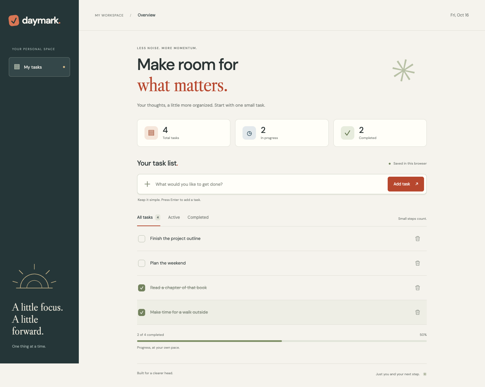

# Daymark ✓

**Make room for what matters.** A simple JavaScript task manager with a calm, responsive interface. Add tasks, check them off, delete them, and come back to your saved list.



[View the mobile preview](docs/preview-mobile.png)

## Start the app

You need [Node.js](https://nodejs.org/) 22 or newer. No package installation is needed to use the app.

```bash
git clone https://github.com/Soumil-Makhija/daymark.git
cd daymark
npm start
```

Open **http://127.0.0.1:4174** in your browser. **Keep the Terminal window and server running while using this link.** Press `Ctrl+C` in Terminal to stop. To use it later, run `npm start` again from this folder.

If you already have this workspace on your Mac:

```bash
cd ~/Desktop/gitHub_practice/daymark
npm start
```

The address is local to your computer; pushing the code to GitHub does not host the website. Opening `index.html` directly will not work because it uses JavaScript modules. Use the included local server.

## What you can do

- Add a task with the button or the Enter key. Whitespace is trimmed; empty tasks are rejected.
- Mark tasks complete and mark them active again.
- Delete a task and undo the most recent deletion during your current visit.
- Switch between All tasks, Active, and Completed.
- See task counts and a completion progress bar.
- Reload the page or close the browser and return to your saved tasks on the same browser and address.
- Use the app with a keyboard, screen reader, phone, tablet, or desktop.

Tasks are limited to 180 characters each and 500 tasks total. No sample tasks are added to your list. Screenshots show illustrative tasks.

## Storage and privacy

Tasks are saved under `daymark:tasks:v1` in **localStorage** on this browser. There is no account, backend, or task data sent to a server. Clearing site data removes the saved list. Lists do not sync between browsers, devices, or addresses: `localhost`, `127.0.0.1`, and different ports have separate storage. Use the same address to return to your list.

If storage is blocked or full, tasks still work for the current visit and a visible warning explains that changes may be lost on reload. Malformed saved records are skipped with a warning while valid records are recovered. Undo history and the selected filter are kept for the current visit only.

The task features work without internet after the page is loaded. Optional fonts are requested from Google Fonts, with built-in font fallbacks if unavailable.

## Test

```bash
npm ci
npm test
npx playwright install chromium
npm run test:e2e
```

On a Mac with Google Chrome installed, you may skip the Chromium download and run:

```bash
PLAYWRIGHT_CHROME=1 npm run test:e2e
```

The suite includes 9 unit tests and 28 browser checks across desktop and mobile layouts. It covers adding, completion, deletion, undo, filtering, reload persistence, empty input, storage failures, damaged data recovery, keyboard interaction, safe text rendering, and screen widths down to 320 pixels. Screenshots are generated under `test-results/` during browser testing. GitHub Actions runs the unit and browser checks on pushes and pull requests.

Automated browser checks use Chromium. The app uses standard APIs supported by current Chrome, Edge, Firefox, and Safari; manual checks in every browser are not included.

## Project structure

```text
index.html                  Accessible page structure
src/app.js                  Task interactions and DOM rendering
src/core.js                 Validation, filtering, storage and progress
src/style.css               Responsive design
scripts/serve.mjs           Dependency-free local server (port 4174)
tests/core.test.mjs          Unit tests
tests/browser/app.spec.js    Browser tests
.github/workflows/test.yml   GitHub Actions checks
docs/                       Desktop and mobile screenshots
```

Built with HTML, CSS, and vanilla JavaScript. No runtime dependencies, API keys, or build step.

## Static hosting

To host it online, upload `index.html`, `favicon.svg`, and `src/` to an HTTPS static host. All asset paths are relative, so repository subpaths work. The included server is for local development.
